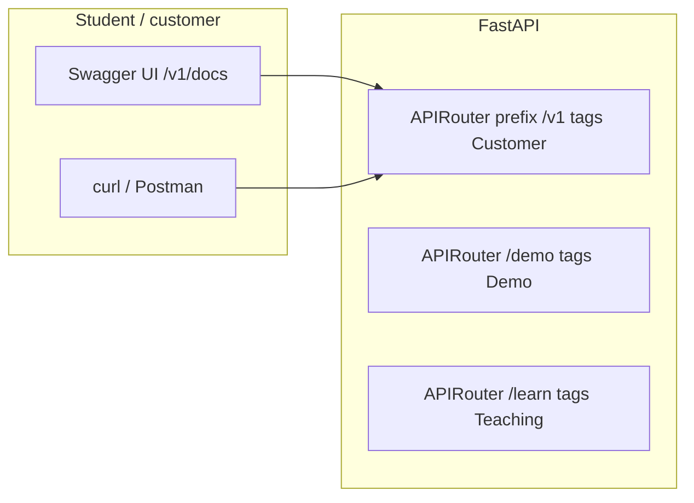

# Customer read API + Swagger UI — implementation plan

**Goal:** Expose a **stable, documented HTTP API** so students, integrators, or a “customer portal” can list **assets** and **findings** (and optional graph context) without using the Vite UI. **Swagger UI** (OpenAPI) is the primary discovery surface.

**Today:** FastAPI serves `/docs` and `/openapi.json` for inventory/findings/graph read routes. **`/learn/*` is registered but omitted from OpenAPI** (`include_in_schema=False`) so Swagger stays customer-facing; teaching labs use the UI and markdown only. Demo `POST /demo/*` still appears in `/docs` until a `/v1` sub-app exists.

---

## Design principles

| Principle | Demo choice | Production analogue |
|-----------|-------------|---------------------|
| **Versioned path** | `/v1/...` | Same as future `netraom-api` |
| **Read-only customer surface** | GET only on `/v1` | Portal read path; writes via pipeline |
| **Stable JSON models** | Pydantic response types + `schema_version` fields where useful | `finding.v1`, portal asset DTO |
| **Tenant scope** | Single demo tenant (header optional) | JWT / API key → `tenant_id` |
| **Separate OpenAPI** | `/v1/openapi.json` + `/v1/docs` | Public catalog vs internal admin |
| **No teaching on `/v1`** | Learn + `/learn/*` stay internal tag | FinOps/admin on separate router |

---

## Scope: what the customer API includes

### Phase 1 — Core (MVP for students)

| Method | Path | Purpose |
|--------|------|---------|
| GET | `/v1/health` | Liveness |
| GET | `/v1/assets` | Paginated inventory (filters: cloud, category, exposed, `q`, sort) |
| GET | `/v1/assets/{asset_id}` | Asset detail + **normalized preview** (trust graph fields) |
| GET | `/v1/assets/{asset_id}/findings` | CSPM + combo findings touching this asset (by `canonical_key` / graph node) |
| GET | `/v1/findings` | Paginated findings (source, severity, rule_id, sort) |
| GET | `/v1/findings/{fingerprint}` | Finding detail |
| GET | `/v1/findings/{fingerprint}/attack-path` | Toxic-combo path (nodes + edges); alias of today’s `/findings/{id}/path` |
| GET | `/v1/assets/facets` | Counts for filters (mirror UI facets) |
| GET | `/v1/findings/facets` | Severity / rule facets |

**Out of scope for `/v1` (remain on root or `/demo`, tag `Demo`):**

- `POST /demo/load`, `POST /demo/reset`
- `/learn/*` (SQL/Cypher labs, inventory JSON browser)
- `POST /learn/sql`, `POST /learn/cypher`

### Phase 2 — Graph read (attack-path API)

| Method | Path | Purpose |
|--------|------|---------|
| GET | `/v1/graph/schema` | Node kinds, edge kinds (CSPM teaching + integrators) |
| GET | `/v1/graph/nodes/{node_id}/neighborhood` | Bounded neighborhood (`depth` 1–3); `{node_id:path}` for ARNs/URLs |
| GET | `/v1/assets/by-graph-node/{graph_node_id}` | Resolve inventory row from `graph_node_id` |

### Phase 3 — Optional exports (teaching / integrations)

| Method | Path | Purpose |
|--------|------|---------|
| GET | `/v1/assets/{asset_id}/provenance` | Raw + normalized JSON package (today’s `/assets/{id}/json`) |
| GET | `/v1/openapi.json` | **Filtered** OpenAPI 3.1 (customer routes only) |

---

## OpenAPI / Swagger UX



### Recommended FastAPI layout

```text
backend/app/
  main.py                 # mount routers, CORS, legacy routes during migration
  api/
    v1/
      __init__.py         # api_v1_router
      assets.py
      findings.py
      graph.py
      health.py
      schemas.py          # AssetV1, FindingV1, PaginatedV1, ErrorV1
    deps.py               # get_tenant_id(), optional verify_api_key()
  openapi_customer.py     # custom OpenAPI subset for /v1/docs
```

**Swagger URLs (target):**

| URL | Audience |
|-----|----------|
| http://localhost:8000/v1/docs | **Customer / student** — only `/v1/*` |
| http://localhost:8000/docs | **Full** demo (all routes); mark deprecated for external use |
| http://localhost:8000/v1/openapi.json | Import into Postman / code generators |

Implementation options:

1. **Sub-app** — `FastAPI()` instance mounted at `/v1` with its own `docs_url="/docs"` → full URL `/v1/docs`. Cleanest separation.
2. **Single app + `include_router(..., include_in_schema=False)`** on demo/learn routes; tag filter in custom `/v1/openapi.json` endpoint.

Prefer **sub-app mount** for a truly public spec.

---

## Authentication (demo vs real)

| Mode | Demo implementation | Notes |
|------|---------------------|--------|
| **Open (classroom)** | No auth; `tenant_id` fixed via `DEMO_TENANT_ID` | Document “local lab only” in README |
| **API key (optional Phase 1b)** | Header `X-API-Key: demo-key` from compose env | Rejects only if key configured; teaches customer integration |
| **Production** | Cognito JWT / m2m API key per tenant | Same route shapes; swap `deps.get_tenant_id` |

Do **not** expose write APIs on `/v1` in the demo repo.

---

## Response models (align with portal)

Define explicit Pydantic models in `api/v1/schemas.py` (re-export from internal dicts initially):

**AssetV1**

- `asset_id`, `graph_node_id`, `canonical_key`, `display_name`, `cloud`, `resource_type`, `region`, `is_internet_exposed`, `props`
- Optional nested `normalized`: `kind`, `graph_props`, `edge_count` (from `build_normalized_preview`)

**FindingV1**

- Match Postgres + portal: `fingerprint`, `source`, `rule_id`, `title`, `description`, `severity`, `ssvc_action`, `exposure`, `canonical_key`, `trust_graph_node_ids`, `path_edges`
- Optional `related_assets[]` on detail endpoints

**PaginatedV1**

```json
{ "items": [], "total": 0, "limit": 50, "offset": 0 }
```

**ErrorV1**

```json
{ "error": { "code": "not_found", "message": "..." } }
```

Reference: [portal-integration.md](./portal-integration.md), vendored `finding.v1` / trust graph schemas.

---

## Implementation phases

| Phase | Deliverable | Effort | Depends on |
|-------|-------------|--------|------------|
| **P0** | Document current `/docs`; link from README | 30 min | — |
| **P1** | `APIRouter` `/v1` — assets + findings list/detail + facets; Pydantic models; `/v1/docs` sub-app | 1–2 days | — |
| **P2** | Graph neighborhood + `by-graph-node`; path alias; integration tests | 1 day | P1 |
| **P3** | Optional API key middleware; env `CUSTOMER_API_KEY` | 0.5 day | P1 |
| **P4** | Deprecate duplicate root paths (keep aliases 302 or same handler) | 0.5 day | P1 |
| **P5** | `docs/customer-api-quickstart.md` — curl examples, Postman collection export | 0.5 day | P1 |
| **P6** | UI “API” link opening `/v1/docs` in new tab | 1 hour | P1 |

**Not in demo repo:** GraphQL, OAuth server, multi-tenant admin, write APIs.

---

## Testing & CI

- **Contract tests:** `tests/test_customer_api_v1.py` — load enterprise fixture, assert `/v1/assets` pagination, `/v1/findings?source=toxic-combo`, OpenAPI schema contains only expected paths.
- **Schemathesis** (optional): fuzz GET `/v1/*` from generated OpenAPI.
- **CI job:** `pytest` + `curl -sf localhost:8000/v1/openapi.json | jq .paths | keys`.

---

## Student narrative (5 minutes)

1. Open **http://localhost:8000/v1/docs**
2. Authorize (if API key enabled) or skip
3. `GET /v1/assets?internet_exposed=true&limit=10`
4. Copy `asset_id` → `GET /v1/assets/{id}`
5. `GET /v1/findings?severity=critical&source=toxic-combo`
6. `GET /v1/findings/{fingerprint}/attack-path` — same data as Findings UI graph

Tie to teaching: SQL labs show **where** rows live; `/v1` shows **how a customer product** exposes them.

---

## Docker / compose

No new services. Same `api` container on port **8000**.

Optional env:

```yaml
environment:
  CUSTOMER_API_KEY: ""          # empty = open
  CUSTOMER_OPENAPI_TITLE: "Netraom CSPM Demo Customer API"
```

---

## Migration from current routes

| Today | Customer API |
|-------|----------------|
| `GET /assets` | `GET /v1/assets` (same query params) |
| `GET /assets/{id}` | `GET /v1/assets/{id}` |
| `GET /findings` | `GET /v1/findings` |
| `GET /findings/{fp}/path` | `GET /v1/findings/{fp}/attack-path` |

Keep old paths for **UI backward compatibility** until Vite `api.ts` switches base path to `/v1` (single env `VITE_API_PREFIX=/v1`).

---

## Success criteria

- [ ] Swagger UI at `/v1/docs` lists **only** customer read endpoints with descriptions and examples.
- [ ] Every `/v1` GET returns documented Pydantic models (no raw SQLAlchemy leaks).
- [ ] README + session runbook link to customer API quickstart.
- [ ] Enterprise load + sample curl script returns assets and critical findings without UI.

---

## Next step

Implement **Phase P1** (router + schemas + `/v1` sub-app docs) in a focused PR; keep demo/learn routes on root app with `include_in_schema=False` on the public sub-app spec.
