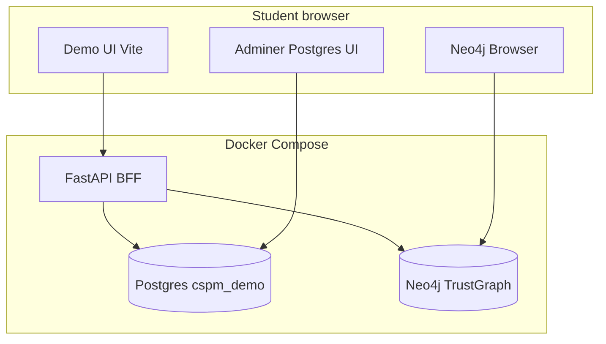

# Teaching console plan — Postgres (RDBMS) + Neo4j (graph)

**Audience:** students learning why Netraom uses **Postgres for portal facts** and **Neo4j/Neptune for paths**, without touching production AWS.

**Note on “GraphQL playground”:** This demo stores the security graph in **Neo4j with Cypher**, not GraphQL. Production stacks often use **Neptune (openCypher / Gremlin)**. Teach with **Cypher** (same query shape). A GraphQL API is optional phase 3 only if you want a GraphQL-specific curriculum.

---

## Goals

| Goal | Tool |
|------|------|
| See **tables, columns, FK-like keys**, sample rows | Postgres admin UI + in-app schema panel |
| Run **SQL** safely (SELECT only) | Adminer + optional SQL lab in demo UI |
| See **nodes, edges, properties** | Neo4j Browser + in-app graph schema panel |
| Run **bounded graph queries** (paths, toxic combos) | Cypher playground with templates |
| Connect UI screens to stores | “How this page is loaded” explainer on Dashboard / Inventory / Findings |

---

## Architecture



**Division of responsibility (teaching script):**

| Store | Holds | Portal analogue |
|-------|--------|-----------------|
| **Postgres** | `assets`, `findings` rows — list, filter, sort, fingerprints | `netraom-api` + Postgres findings/assets |
| **Neo4j** | `TrustGraphNode`, `TRUST_EDGE` — neighborhood, attack paths | Neptune read path / graph-writer |

Misconfig = mostly **one row per asset** in Postgres. Toxic combo = **Postgres finding row** whose `trust_graph_node_ids` / `path_edges` came from a **graph walk** in Neo4j (NetworkX/Cypher in API).

---

## 1. Postgres — “phpMyAdmin-like”

### Option A (recommended v1): **Adminer** in Compose

Add service:

```yaml
adminer:
  image: adminer:4
  ports:
    - "8081:8080"
  depends_on:
    postgres:
      condition: service_healthy
  environment:
    ADMINER_DEFAULT_SERVER: postgres
```

Student login:

- System: **PostgreSQL**
- Server: `postgres` (from host: `localhost`, port **5433**)
- User / password / database: `demo` / `demo` / `cspm_demo`

**Pros:** Zero code, familiar table browse, run SQL, export.  
**Cons:** Full write access — use **read-only role** for class (phase 1b below).

### Option B: **pgAdmin** — heavier, more “enterprise DBA”.

Use only if you already standardize on pgAdmin.

### Phase 1b: Read-only student role

Init SQL (`docker/postgres/02-readonly-user.sql`):

```sql
CREATE ROLE student_ro LOGIN PASSWORD 'student';
GRANT CONNECT ON DATABASE cspm_demo TO student_ro;
GRANT USAGE ON SCHEMA public TO student_ro;
GRANT SELECT ON ALL TABLES IN SCHEMA public TO student_ro;
ALTER DEFAULT PRIVILEGES IN SCHEMA public GRANT SELECT ON TABLES TO student_ro;
```

Adminer login for students: `student` / `student` (SELECT only).

### Teaching queries (Postgres)

Ship `docs/teaching-sql.md` with copy-paste labs:

```sql
-- Inventory slice
SELECT display_name, resource_type, cloud, is_internet_exposed
FROM assets ORDER BY is_internet_exposed DESC NULLS LAST LIMIT 20;

-- Critical misconfigs
SELECT severity, rule_id, title, canonical_key
FROM findings WHERE source = 'cspm' AND severity = 'critical';

-- Toxic combos with graph node ids (bridge to Neo4j)
SELECT title, rule_id, trust_graph_node_ids, path_edges
FROM findings WHERE source = 'toxic-combo' LIMIT 5;
```

---

## 2. Graph — Neo4j Browser + Cypher lab (not GraphQL v1)

### Already available

- **Neo4j Browser:** http://localhost:7474 — `neo4j` / `changeme`
- After `POST /demo/load`, run:

```cypher
MATCH (n:TrustGraphNode {tenant_id: '11111111-1111-4111-8111-111111111111'})
RETURN n.kind, count(*) AS c
```

### Phase 2: In-app **“Graph lab”** page

New route `/learn/graph` in demo UI:

- Left: **schema legend** (from `GET /graph/schema` + static props table from `docs/schema.md`)
- Center: **Cypher editor** (Monaco or textarea) + “Run”
- Right: **Table + small graph** of results (reuse `GraphCanvas` when result is paths)

**API:** `POST /learn/cypher` (read-only):

- Reject queries containing `CREATE`, `DELETE`, `SET`, `MERGE`, `DROP`, `DETACH`
- Require `LIMIT` ≤ 100 (append if missing)
- Inject `tenant_id` filter hint in error messages if missing
- Timeout 5s

Optional: `GET /learn/cypher/templates` — numbered labs T1/T2/D1.

### Teaching queries (Cypher)

Ship `docs/teaching-cypher.md`:

```cypher
// Lab 1 — Public buckets
MATCH (b:TrustGraphNode {kind: 'resource', tenant_id: $tenant})
WHERE b.props CONTAINS 'is_public'
RETURN b.name, b.resource_type LIMIT 25;

// Lab 2 — SSH from internet (edge walk)
MATCH (sg:TrustGraphNode {tenant_id: $tenant})-[r:TRUST_EDGE {kind: 'allows_ingress'}]->(w)
WHERE r.props CONTAINS '22'
RETURN sg.name, w.name LIMIT 25;

// Lab 3 — T2-shaped path (manual)
MATCH (sg:TrustGraphNode {tenant_id: $tenant})-[i:TRUST_EDGE {kind: 'allows_ingress'}]->()
WHERE i.props CONTAINS '22'
MATCH (vm:TrustGraphNode)-[:TRUST_EDGE {kind: 'has_sg'}]->(sg)
MATCH (role:TrustGraphNode {kind: 'identity'})-[:TRUST_EDGE {kind: 'attached_to'}]->(vm)
MATCH (role)-[:TRUST_EDGE {kind: 'can_write'}]->(bucket:TrustGraphNode)
WHERE bucket.props CONTAINS 'is_public'
RETURN vm.name, role.name, bucket.name LIMIT 10;
```

**Production bridge:** Same bounded graph patterns apply in production Neptune/openCypher deployments.

---

## 3. In-app **“Data stores”** explainer

New nav item **Learn** with three sub-pages:

### 3.1 Overview (`/learn`)

Diagram (static or mermaid in UI):

1. Load fixture → API writes **Neo4j** (graph) + **Postgres** (tables).
2. Inventory page → `SELECT` from `assets`.
3. Findings page → `SELECT` from `findings`.
4. Asset graph / combo path → **Neo4j neighborhood** + stored `path_edges`.

Show live counts: `GET /assets/facets`, `GET /findings/facets`, Neo4j node/edge count via `MATCH ... RETURN count(*)`.

### 3.2 Postgres explorer (`/learn/postgres`)

- **Not** a full Adminer embed — use API:
  - `GET /learn/postgres/schema` — columns for `assets`, `findings`
  - `GET /learn/postgres/sample?table=findings&limit=10`
  - `POST /learn/sql` — SELECT-only, same rules as Adminer student role
- UI: table picker, schema cards, result grid (reuse `DataTable`)
- Link: “Open Adminer for full SQL IDE” → `http://localhost:8081`

### 3.3 Graph explorer (`/learn/graph`)

- Schema panel + Cypher lab (above)
- Link: “Open Neo4j Browser” → `http://localhost:7474`
- **Side-by-side lab:** pick a finding fingerprint → show Postgres row JSON **and** Cypher that finds the same nodes in Neo4j

---

## 4. Optional phase 3 — GraphQL (only if curriculum requires it)

If you truly need **GraphQL Playground**:

- Add **Strawberry** or **Ariadne** on FastAPI exposing read-only types: `Asset`, `Finding`, `TrustGraphNode`, `TrustEdge`.
- Resolvers: Postgres for lists; Neo4j for `asset.neighborhood(depth)` and `finding.attackPath`.
- Ship **GraphiQL** at `/graphql` (off in production; on in demo compose only).

**Recommendation:** Defer GraphQL until Cypher/SQL labs land — less duplication, aligns with Neptune path.

---

## 5. Security & classroom ops

| Risk | Mitigation |
|------|------------|
| Students `DELETE` Postgres | `student_ro` role; API SQL endpoint SELECT-only |
| Students melt Neo4j | Cypher endpoint blocks writes; LIMIT + timeout |
| Huge result sets | Hard cap 100 rows; pagination in SQL lab |
| Secrets in compose | Demo passwords only; README “local lab only” |

Reset between classes: existing `POST /demo/reset` + `POST /demo/load`.

---

## 6. Implementation phases

| Phase | Deliverable | Effort |
|-------|-------------|--------|
| **P0** | Adminer in `docker-compose.yml`, `docs/teaching-sql.md`, README links | ~1 h |
| **P1** | Postgres read-only user init SQL | ~30 min |
| **P2** | `docs/teaching-cypher.md` + README Neo4j Browser labs | ~1 h |
| **P3** | API: `/learn/postgres/schema`, `/learn/postgres/sample`, `/learn/sql` (SELECT guard) | ~1 day |
| **P4** | UI: Learn → Overview + Postgres explorer | ~1 day |
| **P5** | API + UI: Cypher lab `/learn/cypher` + templates | ~1–2 days |
| **P6** | “Same finding in both stores” linked lab on Findings detail | ~0.5 day |
| **P7** (optional) | GraphQL + GraphiQL | ~2 days |

---

## 7. UI mock (AppShell)

```
Learn
  Overview          — RDBMS vs graph story + counts
  Postgres tables   — schema + sample rows + SQL lab
  Graph & Cypher    — schema + playground + Neo4j link
  Query cookbook    — links to teaching-sql.md / teaching-cypher.md
```

External tools (open in new tab):

- Adminer → Postgres
- Neo4j Browser → graph

---

## 8. Student narrative (50-minute session)

1. **Load enterprise** from Dashboard — watch counts.
2. **Postgres:** In Adminer, `SELECT * FROM findings WHERE source='toxic-combo' LIMIT 5` — explain columns `trust_graph_node_ids`, `path_edges`.
3. **Neo4j:** Same tenant — Cypher Lab 3 — see **path** as edges, not joins.
4. **Portal UI:** Findings filter **Critical** → click alert → graph matches Cypher result.
5. **Why two stores:** Lists and RBAC-friendly facts in SQL; multi-hop exposure in graph.

---

## 9. Files to add (when implementing)

```text
docker-compose.yml          # adminer service
docker/postgres/02-readonly-user.sql
docs/teaching-sql.md
docs/teaching-cypher.md
backend/app/learn_postgres.py
backend/app/learn_cypher.py
ui/src/pages/learn/OverviewPage.tsx
ui/src/pages/learn/PostgresLabPage.tsx
ui/src/pages/learn/GraphLabPage.tsx
```

No changes to production `netraom-api` required — this stays demo-local.
